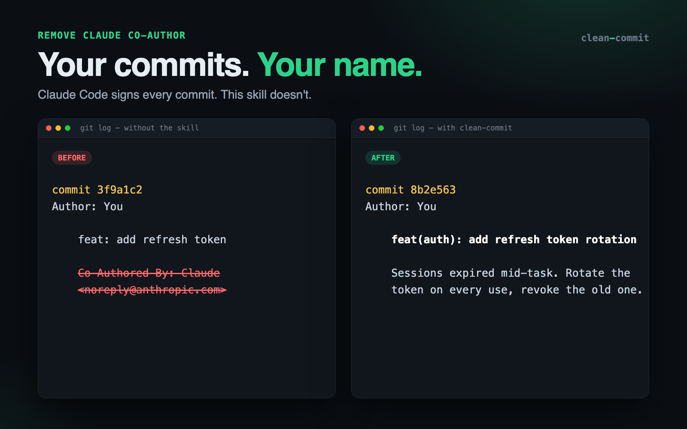
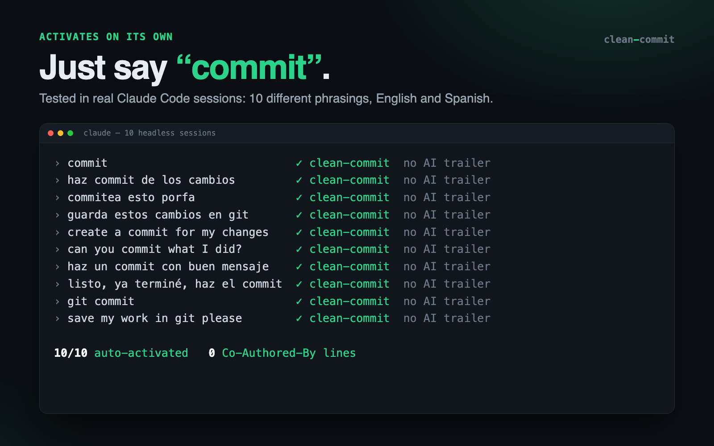
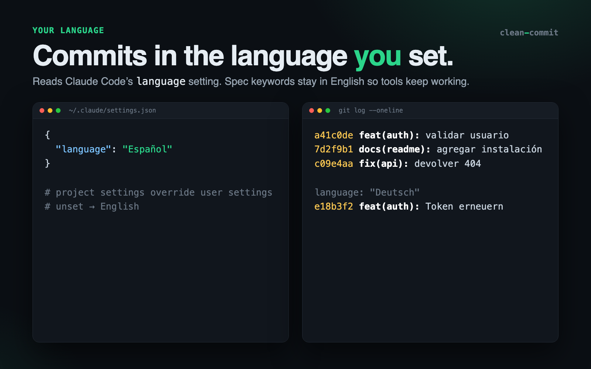
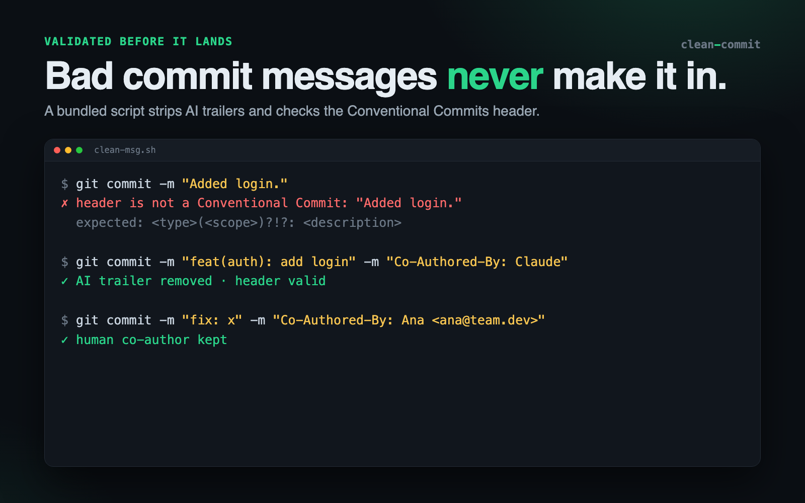
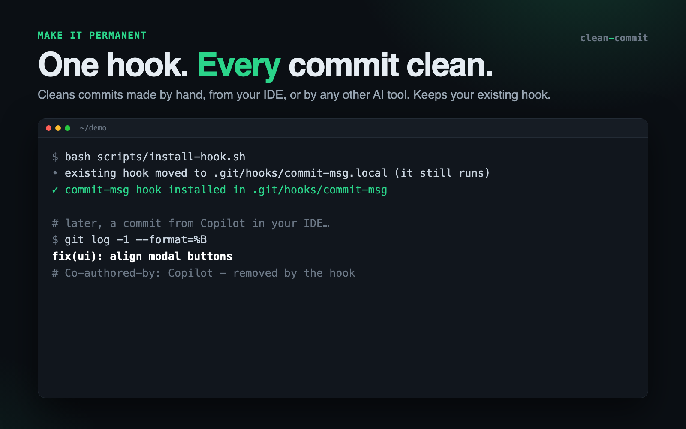
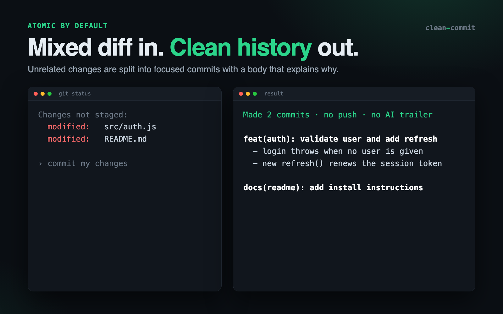

# Remove Claude Co-Author: Pro Commits in Your Language

[](https://agensi.io/skills/remove-claude-co-author-pro-commits-in-your-language)


**Your commits. Your name.** Claude Code signs every commit with
`Co-Authored-By: Claude` and every PR with "Generated with Claude Code".
This skill makes clean, atomic **Conventional Commits** with **zero AI
attribution**, written in the language you configured in Claude Code.



## Install

👉 **[Install it free on Agensi](https://agensi.io/skills/remove-claude-co-author-pro-commits-in-your-language)**

Or manually: copy `SKILL.md`, `references/`, and `scripts/` into
`~/.claude/skills/clean-commit/`.

## Use

Just ask for a commit. The skill activates on its own:

```
commit
commit my changes
haz commit de los cambios
save my work in git please
```

Optional extras, on request:

- "install the clean-commit hook in this repo" — a `commit-msg` hook that
  strips AI attribution from every commit, even ones made by hand or by
  other AI tools.
- "turn off Claude attribution globally" — sets Claude Code's
  `attribution` setting (with a backup).

## What you get

| | |
|---|---|
| **No AI attribution** | Strips Claude, Copilot, ChatGPT, Cursor, Codex, and Gemini trailers. Keeps human co-authors. |
| **Activates on its own** | 10/10 automatic activations across different phrasings in real Claude Code sessions. |
| **Your language** | Follows Claude Code's `language` setting; `feat`, `fix`, `BREAKING CHANGE` stay in English. |
| **Atomic commits** | Splits unrelated changes into focused commits with a body that explains why. |
| **Validated** | Rejects malformed headers before the commit lands. |
| **Safe** | Never commits secrets, never uses `--no-verify`, never pushes unless asked. |







## Layout

- `SKILL.md` — English router: precedence, rules, flow.
- `references/` — `conventional-commits.md`, `attribution.md`.
- `scripts/` — `clean-msg.sh` (strip + validate), `install-hook.sh`
  (per-repo hook), `detect-language.sh` (reads Claude Code `language`).
  Bash only, no network, no dependencies beyond git (`jq` optional).
- `tests/run.sh` — script tests in throwaway repos.
- `marketplace/` — Agensi listing copy, logo, screenshots and their
  sources (`marketplace/src/render.sh` rebuilds them with headless Chrome).

## Develop

```bash
bash tests/run.sh                          # 26 tests, temp repos and temp HOME only
zip -r clean-commit.zip SKILL.md references scripts   # shipping ZIP
```

Ship updates through the Agensi MCP (`update_skill`) or the dashboard.
Never include `marketplace/` or `tests/` in the ZIP.

## Support

Open an [issue](https://github.com/AloreBB/clean-commit/issues).

## License

Apache 2.0. See [`LICENSE`](LICENSE).
